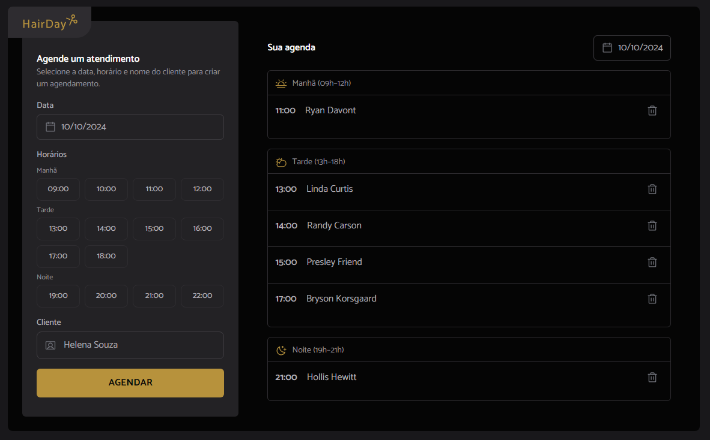

# HairDay React App

Uma interface de agendamento moderna construída com **React**, **TypeScript**, **Tailwind CSS** e **tailwind‑variants**.
Ela demonstra arquitetura de componentes reutilizáveis (Button, TextInput, TimeSelect, etc.) e boas práticas de acessibilidade.

## 👀 Visão Geral



_A captura de tela mostra o layout principal com a barra lateral (seletor de data, horários, campo de nome do cliente) e a listagem da agenda._

## 📦 Instalação

```bash
# clonar o repositório
git clone https://github.com/your-username/hairday-react.git
cd hairday-react

# instalar dependências
npm install

# iniciar servidor de desenvolvimento
npm run dev
```

O app roda em `http://localhost:5173` por padrão.

## 🚀 Funcionalidades

- **Componentes reutilizáveis**: `Button`, `TextInput`, `TimeSelect`, `Icon`, etc.
- **Tailwind‑variants** para estilos configuráveis via `tv`.
- **SVGR** (`?react`) para usar ícones SVG como componentes React.
- **Acessibilidade**: labels corretas com `htmlFor`, atributos ARIA nos ícones, contraste de cores.
- **UI orientada a estado**: data, horário e cliente armazenados no estado do React.

## 🧩 Visão dos Componentes

| Componente   | Propósito                                                                                    | Principais Props                          |
| ------------ | -------------------------------------------------------------------------------------------- | ----------------------------------------- |
| `Button`     | Botão clicável com estilos de hover/focus                                                    | `children`, `onClick?`, `className?`      |
| `TextInput`  | Campo de texto com quatro estados visuais (vazio/preenchido × default/ativo)                 | `id`, `placeholder`, `value`, `onChange`  |
| `TimeSelect` | Botão de intervalo de horário com estados **default**, **hover**, **selected**, **disabled** | `time`, `state?`, `selected?`, `onClick?` |
| `Icon`       | Wrapper que renderiza um componente SVG (`svg` prop) com classes Tailwind opcionais          | `svg`, `className?`, `aria-hidden?`       |
| `Logo`       | Componente de marca (logo) que usa imagem estática da pasta `public/`                        |
| `ButtonIcon` | Botão circular ou quadrado contendo apenas um ícone (ex.: lixeira)                           | `svg`, `onClick?`, `className?`           |

## 🎨 Estilização

Todos os componentes utilizam utilitários do **Tailwind CSS** e **tailwind‑variants** (`tv`) para definir strings de classes por variante. Exemplo:

```tsx
const buttonVariants = tv({
  base: "flex items-center justify-center rounded-md",
  variants: {
    intent: {
      primary: "bg-yellow-500 text-white",
      secondary: "bg-gray-700 text-gray-200",
    },
    size: {
      sm: "px-2 py-1 text-sm",
      md: "px-4 py-2",
    },
  },
  defaultVariants: {
    intent: "primary",
    size: "md",
  },
});
```

## 🛠️ Fluxo de Desenvolvimento

1. **Rodar testes** (se houver)
   ```bash
   npm run test
   ```
2. **Lint e formatação**
   ```bash
   npm run lint   # Biome lint
   npm run format # Prettier
   ```
3. **Build para produção**
   ```bash
   npm run build
   ```

## 📄 Licença

MIT – sinta‑se livre para usar, modificar e distribuir.

---

_Para substituir a captura de tela placeholder (`./assets/screenshot.png`) por uma imagem real, execute o app localmente, tire uma screenshot da tela inicial (por exemplo, usando a Ferramenta de Recorte do Windows) e coloque‑a na pasta `src/assets/` ou `public/assets/`._
